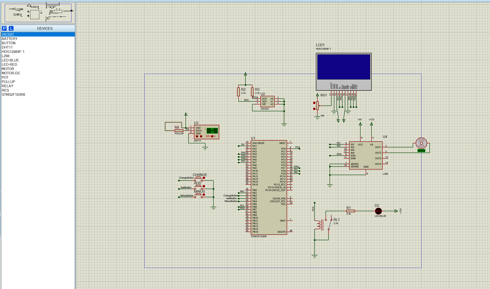

# TDDC

基于 **STM32F103R6** 的温湿度监测与闭环控制仿真系统。硬件在 **Proteus** 中搭建，固件由 **STM32CubeMX + CMake/Ninja + arm-none-eabi-gcc** 构建。

DHT11 采集环境温湿度，显示在一块 HDG12864F-1（SED1565 驱动，128×64）串行液晶上。三个按键可在五个界面之间切换，分别设置温度与湿度的上限、下限；阈值写入 AT24C02 EEPROM 掉电保存，开机自动读回。温度高于上限时由 TIM3 输出 PWM 经 L298 驱动电机，低于下限时由继电器吸合接通电阻加热，构成双向温度闭环。

## 功能

| 功能 | 实现 |
|---|---|
| 温湿度采集 | DHT11 单总线，主循环轮询 |
| 本地显示 | HDG12864F-1 128×64 液晶，自绘 16×16 汉字字模 |
| 界面切换 | 5 屏菜单，两档刷新（整屏重铺 / 只刷数字）避免闪烁 |
| 参数设置 | 3 个按键，EXTI 下降沿中断触发 |
| 掉电保存 | AT24C02 EEPROM，软件 I²C 位操作驱动 |
| 电机控制 | TIM3 PWM（10 kHz）驱动 L298 |
| 加热控制 | 继电器吸合接通电阻加热 |

### 界面

| `ui_mode` | 界面 | 屏幕显示 |
|---|---|---|
| 0 | 显示模式 | `温度 : 25℃` / `湿度 : 60%RH` |
| 1 | 温度上限 | 底部显示 `温度上限 40` |
| 2 | 温度下限 | 底部显示 `温度下限 0` |
| 3 | 湿度上限 | 底部显示 `湿度上限 70` |
| 4 | 湿度下限 | 底部显示 `湿度下限 0` |

### 按键

| 按键 | 引脚 | 功能 |
|---|---|---|
| 切换 | PB2 | 依次在 5 个界面之间循环 |
| 加 | PB3 | 当前界面的阈值 +1（上限 99） |
| 减 | PB4 | 当前界面的阈值 −1（下限 0） |

在显示模式（`ui_mode == 0`）下，加 / 减键不生效。

### 参数存储

AT24C02 的地址分配（`main.c` 中的 `ADDRxx` 宏）：

| 地址 | 宏 | 内容 | 默认值 |
|---|---|---|---|
| `0x00` | `ADDRTM` | 温度上限 | 40 |
| `0x01` | `ADDRTL` | 温度下限 | 0 |
| `0x02` | `ADDRHM` | 湿度上限 | 70 |
| `0x03` | `ADDRHL` | 湿度下限 | 0 |
| `0xFF` | — | `at24cxx_check()` 占用 | — |

**空片判断**：EEPROM 出厂状态是所有位为 1，即读出 `0xFF`。开机时读 `ADDRTM`，若为 `0xFF` 就认为芯片是空的，写入上面那组默认值；否则把四个地址的值读回变量。所以第一次上电自动初始化，之后一直用存下来的值。

只有按下加 / 减键才会触发写 EEPROM（`ee_save` 标志），避免每轮循环都写。

### 控制逻辑

主循环每轮读一次温度，分别与上限、下限比较。两路执行机构是独立的，同一时刻最多只有一路动作：

| 条件 | 电机（L298，PC8 / PC9） | 继电器（PC0） |
|---|---|---|
| 温度 ≥ 温度上限 | IN1 = 100%、IN2 = 0 → 正转 | 断开 |
| 温度 ≤ 温度下限 | IN1 = IN2 = 0 → 停 | **吸合，电阻加热** |
| 两者之间 | 停 | 断开 |

湿度上下限目前只做记录与显示，没有接执行机构。

## 硬件连接



| 外设 | 信号 | 引脚 |
|---|---|---|
| DHT11 | DQ | PA1 |
| HDG12864F-1 | CS（片选，低有效） | PA4 |
| | SCL（串行时钟） | PA5 |
| | RD / RST（读控制 / 复位） | PA6 |
| | SI（串行数据） | PA7 |
| | A0（命令 / 数据选择） | PB1 |
| AT24C02 | SCL | PB6 |
| | SDA | PB7 |
| 按键 ×3 | 切换 / 加 / 减 | PB2 / PB3 / PB4 |
| L298 | IN1 — TIM3_CH3 | PC8 |
| | IN2 — TIM3_CH4 | PC9 |
| 继电器 | RL1（3.3V）控制线圈 | PC0 |
| 指示 LED | D2（蓝色），经 R1 0.3k | PC0 |

PC0 上同时挂着继电器线圈和一颗指示 LED，吸合时 LED 同步亮起。

另外几个非单片机控制的外围：RV1（10 kΩ 电位器）接液晶的 `VOUT` 调对比度；R2 / R3（4.7 kΩ）是 I²C 总线的上拉电阻；R4 是 DHT11 数据线的上拉。

TIM3 配置为 `PSC = 71`、`ARR = 99`，计数频率 1 MHz，PWM 频率 **10 kHz**，占空比 = `CCR / 100`。

## 目录结构

```
TDDC/
├── Core/
│   ├── Inc/              头文件
│   └── Src/
│       ├── main.c            主逻辑：初始化、主循环、界面绘制
│       ├── gpio.c / tim.c    CubeMX 生成的引脚与定时器配置
│       ├── dht11.c           DHT11 单总线驱动
│       ├── HDG12864F1.c      液晶驱动 + 汉字字模
│       └── stm32f1xx_*.c     HAL 中断、MSP、启动相关
├── Drivers/              STM32F1xx HAL 与 CMSIS
├── cmake/                CMake 工具链配置
├── tools/
│   └── gen_hdg_font.py       汉字点阵生成脚本
├── docs/
│   └── schematic.png         原理图
├── CMakeLists.txt
├── CMakePresets.json
├── STM32F103xx_FLASH.ld
├── startup_stm32f103x6.s
├── TDDC.ioc              STM32CubeMX 工程
└── TDDC.pdsprj           Proteus 仿真工程
```

## 构建

```bash
cmake --preset Debug
cmake --build --preset Debug
```

产物为 `build/Debug/TDDC.hex`。

## 在 Proteus 中运行

`TDDC.pdsprj` 里 STM32F103R6 的 Program File 已经指向 `build\Debug\TDDC.hex`，重新编译后直接启动仿真即可。

## 字模工具

`tools/gen_hdg_font.py` 从 Windows 系统字体生成 16×16 汉字点阵，输出可直接贴进 `HDG12864F1.c`。依赖 Pillow。

```bash
python tools/gen_hdg_font.py            # 生成 CHARS 里的全部字
python tools/gen_hdg_font.py 显示模式    # 只生成指定的字
```

字模格式：一个汉字 = `Upper[16] + Lower[16]`，共 32 字节。`Upper` 是上半页（第 0–7 行），`Lower` 是下半页（第 8–15 行）；每个字节表示一列上的 8 个像素，数组下标即列号，`bit0` 为该页最上一行。

## 开发环境

- STM32CubeMX（`TDDC.ioc`）
- arm-none-eabi-gcc 14.3.1
- CMake + Ninja
- Proteus 8
- VSCode + STM32 VS Code Extension（补全与跳转由扩展自带的 clangd 提供）
